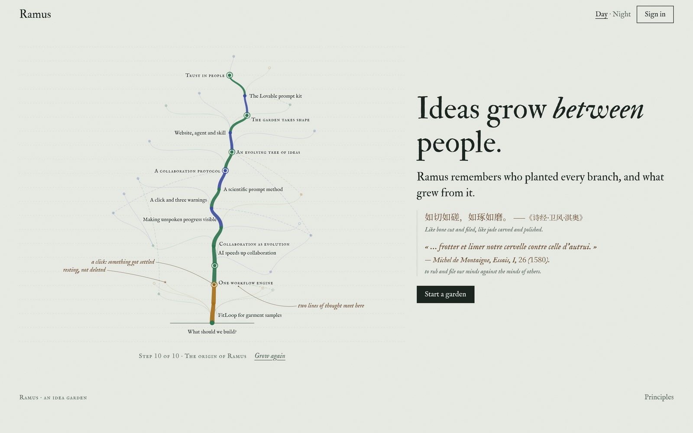

# Ramus

**If life evolves, why not ideas?**

Ramus turns conversations into an evolutionary tree of ideas. You can see where an idea started, how it branched and merged, and who planted each branch.

**Try it:** [ramus-watch-ideas-grow.lovable.app](https://ramus-watch-ideas-grow.lovable.app), no account needed for your first tree.



> You can trace how a species evolved. Ramus lets you trace how an idea evolved.

## Why

Good ideas rarely appear all at once. They start as a sentence, then get questioned, changed, split and combined over many conversations with teammates, friends or an AI.

Chat history keeps every word but hides that story. An AI summary gives you the conclusion and loses the path to it.

## What it does

Bring in your conversations: WhatsApp groups, ChatGPT or Claude exports, Slack, meeting transcripts, or plain notes. Ramus reads them in time order and grows a tree.

- **See the evolution.** Where each idea began, and how it branched, merged and changed, step by step.
- **Trace the source.** Click any branch to read the exact messages, when they were said, and who said them.
- **Keep what was set aside.** Abandoned ideas stay on the tree, resting, ready to grow again.
- **Go back and regrow.** When a group returns to an earlier idea, the tree grows a new branch from there.
- **Show the journey.** Read the tree as a story, present it step by step, or download it as a poster (PNG or SVG).

The AI in Ramus is a gardener, not a planter. It sorts, links and asks, but every idea on the tree belongs to someone who said it. Phone numbers and email addresses are masked before anything is read.

## How it is different

| Tool | What it shows |
|---|---|
| A mind map | What you think now |
| A chat log | What was said |
| Ramus | How the thinking evolved |

Ramus works like a phylogenetic tree for ideas: each idea has a lineage, and every branch has a source. Unlike genes, ideas can also merge, so two lines of thought can grow into one.

## The first tree

The tree on the home page is real. It is the brainstorm between the founder, ChatGPT and Claude that became Ramus: 34 ideas over 10 steps, from “What should we build?” to “Trust in people”.

## Built with

- TanStack Start and React
- Lovable Cloud (Supabase)
- Gemini and GPT through the Lovable AI gateway
- Fell types and Noto Serif SC, self-hosted

The look borrows from Darwin’s 1837 “I think” sketch, herbarium sheets, Linnaeus, Bringhurst and Tufte. The rules behind it are in [docs/design-principles.md](docs/design-principles.md).

## Run it locally

```sh
bun install
bun run dev
```

You need a `.env` with a Supabase URL and publishable key. Run the tests with `bun run test`.

## 中文简介

我们可以追溯一个物种是怎么进化来的，Ramus 让你追溯一个想法是怎么产生的。

把你和团队、朋友或 AI 的聊天记录放进去，Ramus 会把其中的想法长成一棵进化树：每个想法从哪里来，怎样分叉、融合，又是谁种下的，一眼就能看清。

**在线试用：** [ramus-watch-ideas-grow.lovable.app](https://ramus-watch-ideas-grow.lovable.app)，第一棵树不用注册。
